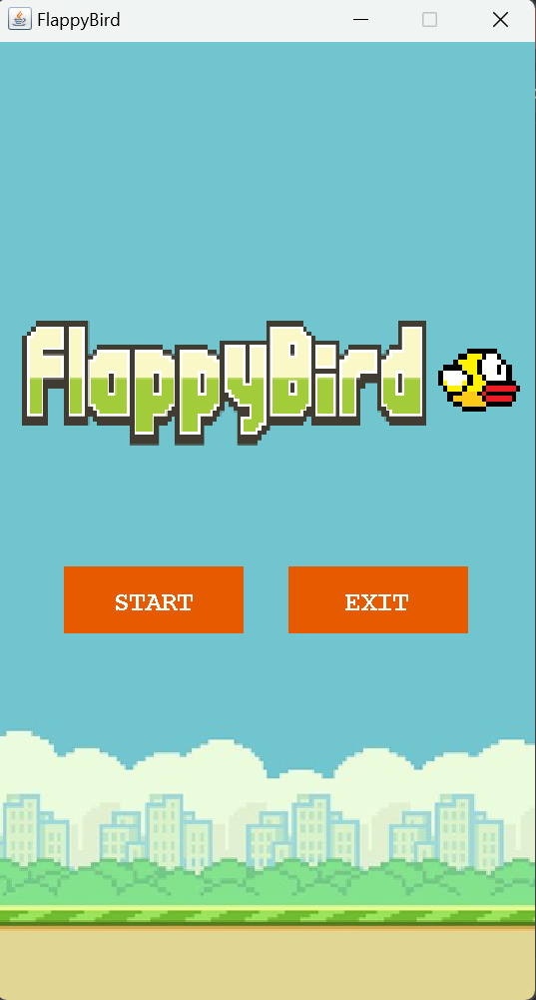

# Tugas Praktikum DPBO 6

## Deskripsi Program

Flappy Bird merupakan permainan sederhana berbasis Java menggunakan GUI (Graphical User Interface) dengan library Swing. Pemain mengendalikan seekor burung yang harus melewati rintangan berupa pipa atas dan bawah tanpa menabraknya atau terjatuh ke batas bawah layar.

Permainan ini dilengkapi dengan Main Menu, sistem perhitungan skor, Game Over, fitur restart, serta audio sebagai pendukung pengalaman bermain.

## 1. Desain Program

### A. Struktur Class

Program ini terdiri dari beberapa class yang memiliki tanggung jawab masing-masing dalam menjalankan permainan.

| Class | Deskripsi |
|---|---|
| `App` | Menjadi titik awal program, membuat JFrame, mengatur CardLayout, dan menghubungkan Main Menu dengan permainan. |
| `MainMenu` | Menampilkan halaman awal permainan yang terdiri dari tombol START dan EXIT. |
| `Logic` | Mengatur logika permainan, pergerakan player dan pipe, collision detection, perhitungan skor, Game Over, serta input keyboard. |
| `View` | Mengatur tampilan permainan, menggambar player dan pipe, menampilkan skor, serta menampilkan panel Game Over. |
| `Player` | Menyimpan atribut dan mengatur data player, seperti posisi, ukuran, gambar, dan kecepatan gerak. |
| `Pipe` | Menyimpan atribut rintangan berupa posisi, ukuran, gambar, kecepatan, dan status apakah pipa sudah dilewati. |
| `Sound` | Mengatur pemutaran audio, termasuk musik latar dan suara ketika permainan berakhir. |

### B. Struktur Folder

Berikut merupakan struktur folder program:

```text
TP6DPBO2526C2/
│
├── Dokumentasi/
│   ├── main_menu.png
│   └── Dokumentasi_TP6.mp4
│
├── FlappyBird/
│   ├── .idea/
│   ├── out/
│   ├── src/
│   │   ├── App.java
│   │   ├── MainMenu.java
│   │   ├── Logic.java
│   │   ├── View.java
│   │   ├── Player.java
│   │   ├── Pipe.java
│   │   ├── Sound.java
│   │   │
│   │   └── assets/
│   │       ├── background.png
│   │       ├── logo.png
│   │       ├── bird.png
│   │       ├── lowerPipe.png
│   │       ├── upperPipe.png
│   │       │
│   │       ├── audio/
│   │       │   ├── MainTheme.wav
│   │       │   └── Die.wav
│   │       │
│   │       └── font/
│   │           └── FlappyBird.ttf
│   │
│   ├── .gitignore
│   └── FlappyBird.iml
│
└── README.md
```

### C. Desain Antarmuka

Program memiliki tiga tampilan utama, yaitu:

**1. Main Menu**

Main Menu merupakan halaman awal yang ditampilkan ketika program dijalankan. Halaman ini memiliki dua tombol utama:

- **START**: Memulai permainan dan menampilkan halaman permainan.
- **EXIT**: Mengakhiri program.

**2. Game Screen**

Game Screen merupakan halaman utama permainan yang menampilkan:

- Background permainan.
- Player berupa gambar burung.
- Rintangan berupa pipa atas dan bawah.
- JLabel untuk menampilkan skor selama permainan berlangsung.

**3. Game Over**

Game Over ditampilkan ketika player menabrak pipa atau terjatuh melewati batas bawah layar. Panel ini menampilkan tulisan GAME OVER, skor akhir, serta petunjuk tombol keyboard untuk melakukan restart, kembali ke Main Menu, atau keluar dari permainan.


## 2. Penjelasan Alur Program

### A. Inisialisasi Program

Ketika program dijalankan, method `main()` pada class `App` akan membuat JFrame sebagai jendela utama permainan.

Selanjutnya, program membuat objek `CardLayout` untuk mengatur perpindahan tampilan antara Main Menu dan Game Screen. Program juga membuat objek `Sound` untuk mengatur audio permainan.

Main Menu ditampilkan pertama kali dan musik latar `MainTheme.wav` mulai diputar secara berulang.

### B. Main Menu

Pada halaman Main Menu, pemain dapat memilih salah satu dari dua tombol yang tersedia.

- Ketika tombol START ditekan, program membuat objek `Logic` dan `View`, kemudian menampilkan Game Screen.
- Ketika tombol EXIT ditekan, program menghentikan audio dan mengakhiri permainan.

### C. Memulai Permainan

Setelah Game Screen ditampilkan, player dan objek permainan diinisialisasi.

Permainan belum langsung berjalan sampai pemain menekan tombol SPACE. Ketika SPACE ditekan, status `gameStarted` berubah menjadi `true`, kemudian `gameLoop` dan `pipesCooldown` mulai dijalankan.

Game Loop menggunakan `Timer` dengan interval sekitar 60 FPS untuk memperbarui kondisi permainan.

### D. Pergerakan Player

Player dikendalikan menggunakan tombol SPACE.

Ketika tombol SPACE ditekan, kecepatan vertikal player diatur menjadi `-10` sehingga player bergerak ke atas.

Sementara itu, gravitasi akan terus menambah kecepatan vertikal player sehingga player kembali bergerak ke bawah.

Perhitungan pergerakan player dilakukan menggunakan rumus:

```text
velocityY = velocityY + gravity
posY = posY + velocityY
```

Dengan mekanisme tersebut, player dapat bergerak naik dan turun menyerupai gerakan burung pada permainan Flappy Bird.

### E. Pembuatan dan Pergerakan Pipe

Objek pipe dibuat secara berkala menggunakan `pipesCooldown` dengan interval 1500 milidetik.

Setiap rintangan terdiri dari dua objek, yaitu upper pipe dan lower pipe. Posisi vertikal pipa ditentukan secara acak sehingga jarak antar kedua pipa membentuk celah yang harus dilewati player.

Pipe bergerak dari kanan ke kiri menggunakan kecepatan horizontal yang telah ditentukan.

### F. Perhitungan Skor

Skor bertambah ketika player berhasil melewati pipa.

Setiap pasangan rintangan terdiri dari dua objek, yaitu upper pipe dan lower pipe. Masing-masing objek memberikan tambahan skor sebesar 0,5.

Dengan demikian, perhitungan skor dilakukan menggunakan:

```java
score += 0.5f;
```

Status `passed` digunakan untuk memastikan setiap objek pipe hanya memberikan tambahan skor satu kali.

Skor ditampilkan melalui `JLabel` pada class `View`.

### G. Collision Detection

Program menggunakan metode Axis-Aligned Bounding Box (AABB) untuk mendeteksi tabrakan antara player dan pipe.

Tabrakan terjadi ketika area player dan area pipe saling beririsan.

Selain itu, program juga memeriksa apakah posisi bawah player telah melewati batas bawah layar.

Kondisi Game Over terjadi ketika:

1. Player menabrak upper pipe.
2. Player menabrak lower pipe.
3. Player terjatuh melewati batas bawah JFrame.

### H. Game Over

Ketika salah satu kondisi Game Over terpenuhi, program akan:

1. Menghentikan `gameLoop`.
2. Menghentikan `pipesCooldown`.
3. Memutar audio `Die.wav` satu kali.
4. Menampilkan panel Game Over.
5. Menampilkan skor akhir pemain.

### I. Restart Permainan

Ketika Game Over, pemain dapat menekan tombol R untuk melakukan restart.

Program akan mengatur ulang posisi dan kecepatan player, menghapus seluruh pipe, mengembalikan skor menjadi 0, serta mengatur ulang status permainan.

Setelah restart, permainan kembali ke kondisi awal dan menunggu pemain menekan SPACE untuk memulai permainan.

### J. Kembali ke Main Menu dan Keluar

Pada kondisi Game Over, pemain juga dapat memilih:

- **M**: Menghentikan audio dan kembali ke Main Menu.
- **E**: Menghentikan audio dan keluar dari program.

## 3. Kontrol Permainan

Berikut merupakan daftar tombol yang digunakan untuk mengendalikan permainan.

| Tombol | Fungsi |
|---|---|
| SPACE | Memulai permainan dan menggerakkan player ke atas. |
| R | Melakukan restart ketika Game Over. |
| M | Kembali ke Main Menu ketika Game Over. |
| E | Keluar dari permainan ketika Game Over. |
| START | Memulai permainan melalui Main Menu. |
| EXIT | Keluar dari permainan melalui Main Menu. |

## 4. Dokumentasi Program

Dokumentasi berikut berisi screenshot dan screen recording yang menunjukkan tampilan serta proses berjalannya program.

**1. Main Menu**

Menampilkan halaman awal permainan yang terdiri dari background, logo Flappy Bird, gambar burung, serta tombol START dan EXIT.

<p align="left">
  
</p>


**2. Screen Recording**

https://github.com/user-attachments/assets/e585a8a4-887a-4a19-9f4b-eb9161c8bd9c


Screen recording berikut menunjukkan keseluruhan proses permainan, mulai dari Main Menu, permainan berlangsung, perhitungan skor, hingga kondisi Game Over dan fitur restart.


**Gameplay Flappy Bird**

## 6. Cara Menjalankan Program

1. Pastikan Java Development Kit (JDK) sudah terpasang.
2. Buka project Flappy Bird menggunakan IDE yang mendukung Java.
3. Pastikan seluruh file gambar, font, dan audio berada pada folder `assets`.
4. Pastikan seluruh file Java berada pada package atau source folder yang sesuai.
5. Jalankan file `App.java`.
6. Tekan tombol START untuk memulai permainan.

---

